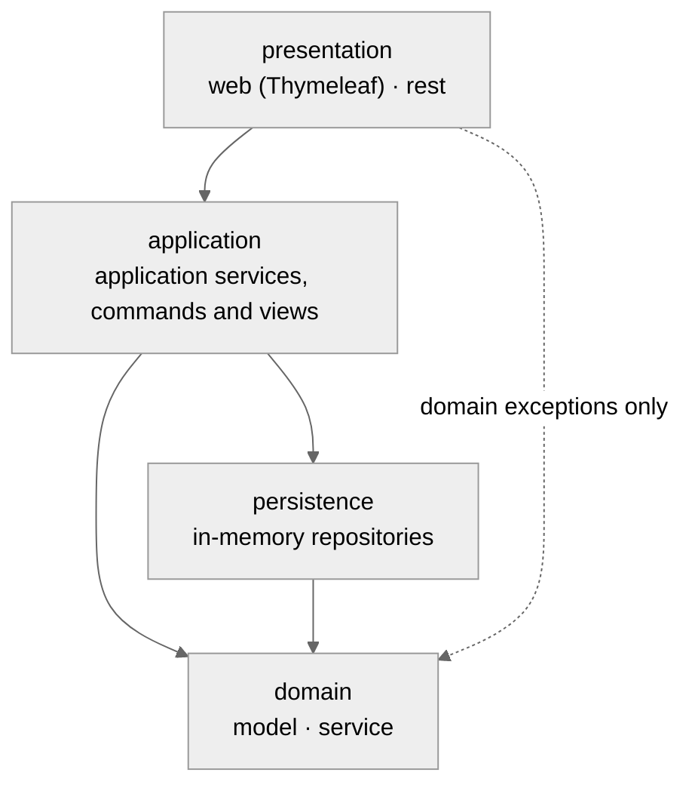
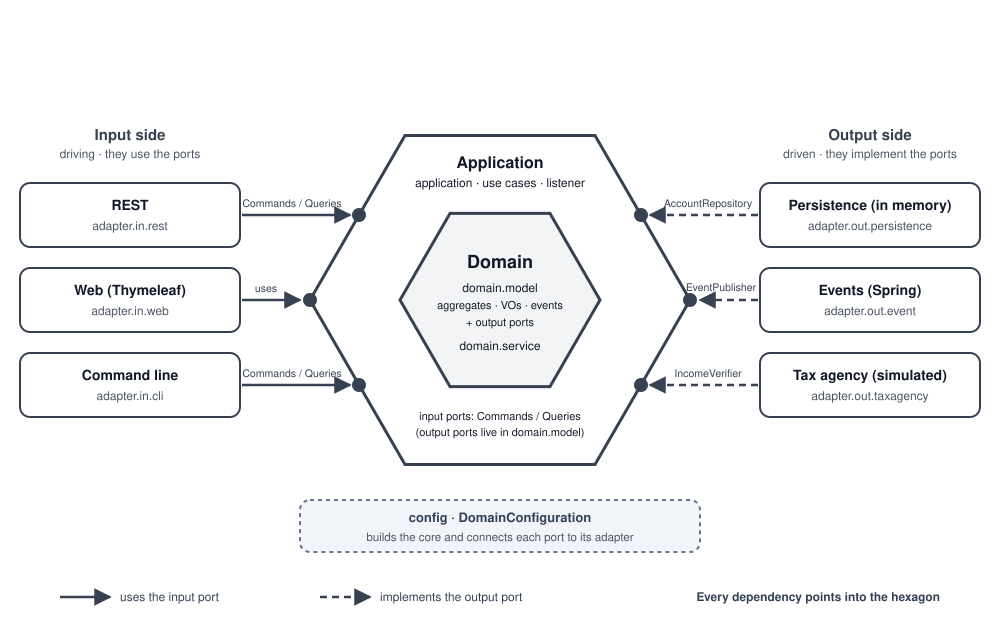
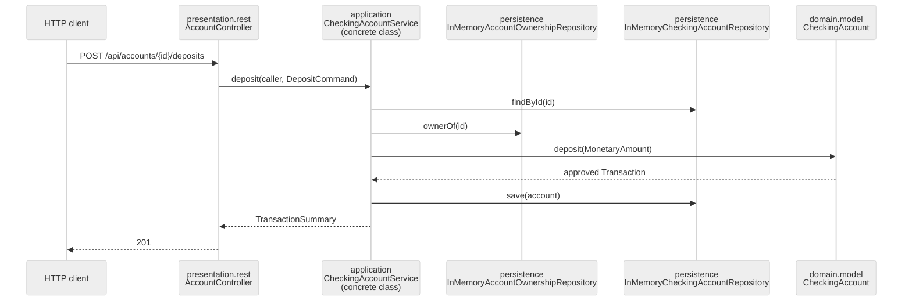
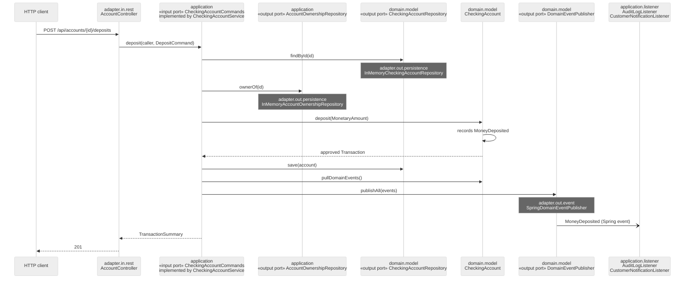

# Layers vs hexagonal: comparing the two phases

The project keeps two snapshots of the same checking-accounts domain: the **layered monolith** of phase 1 (tag `v1-monolito`, branch `Monolithic`) and the **ports and adapters** architecture of phase 2 (tag `v2-hexagonal`, branch `Hexagonal`). The domain rules (R1-R20 of the [glossary](../dominio/glosario.md)), the REST API and the screens are the same in both; what changes is **who depends on whom** and how each piece is tested. Design of each phase: [phase 1](fase-1-capas.md) · [phase 2](fase-2-hexagonal.md); decisions: [ADR 0004](../adr/0004-arquitectura-en-capas.md) and [ADR 0006](../adr/0006-hexagonal-architecture.md).

## The two architectures

**Phase 1 · layers.** Dependencies go downwards: `presentation` → `application` → `domain` and `persistence`, and `persistence` → `domain`. The application service uses concrete classes, with no port interfaces (ADR 0004).



**Phase 2 · hexagonal.** Dependencies point into the hexagon from both sides: input adapters **use** the input ports of `application`, and output adapters **implement** the output ports declared by the domain (and the ownership port of `application`). `config` builds the core and hands it the adapters.



## The same deposit in both phases

`POST /api/accounts/{id}/deposits` by the owner of the account. Request validation (400) and error translation are left out of both diagrams: they are the same in both phases (see the deposit flow in [phase 1](fase-1-capas.md#example-flow-a-deposit)).

**Phase 1:** every call reaches a concrete class.



**Phase 2:** the controller only knows the input port; the service only knows output ports, each implemented by an adapter (dark notes); the domain events recorded by the aggregate are published after saving.



| | Phase 1 | Phase 2 |
| - | ------- | ------- |
| The controller knows | `CheckingAccountService` (concrete) | `CheckingAccountCommands` (interface) |
| The service knows | `InMemoryCheckingAccountRepository`, `InMemoryAccountOwnershipRepository` (concrete) | `CheckingAccountRepository`, `AccountOwnershipRepository`, `DomainEventPublisher` (interfaces) |
| Who builds the service | Spring (`@Service`), which builds `MoneyTransferService` with `new` inside it | `config.DomainConfiguration` (`@Bean`), with no Spring annotation in the core |
| After saving | nothing | `MoneyDeposited` reaches the audit and customer-notification listeners |

## What changed in each package

| Phase 1 (`v1-monolito`) | Phase 2 (`v2-hexagonal`) | What changed | Issue |
| ----------------------- | ------------------------ | ------------ | ----- |
| `presentation` (root) | `adapter.in` (root) | Moved: security support shared by the input adapters (`SecuritySupport`, `CurrentCaller`, `SecurityUsersProperties`) | #14 |
| `presentation.rest` | `adapter.in.rest` | Moved; controllers use `CheckingAccountCommands`/`CheckingAccountQueries` instead of the service; opening by NIF | #14, #16, #18 |
| `presentation.web` | `adapter.in.web` | Moved; same change of dependency; opening form asks for the NIF | #14, #16, #18 |
| `application.DemoDataLoader` | `adapter.in.cli.DomainModelRunner` | The demo data becomes a command-line input adapter that only uses `CheckingAccountCommands`, with a `[demo]` trace; it also deposits, withdraws and transfers | #19 |
| `application` | `application` | Gains the input ports (`CheckingAccountCommands`, `CheckingAccountQueries`) and the output port `AccountOwnershipRepository`; the service implements both input ports, opens accounts through the factory, publishes events after saving and loses `@Service` | #15, #16, #17, #18, #20 |
| — | `application.listener` | New: event consumers `AuditLogListener`, `CustomerNotificationListener` (keep `@EventListener`) | #17, #20 |
| `domain.model` | `domain.model` | Gains the output ports (`CheckingAccountRepository`, `DomainEventPublisher`, `AccountNumberSequence`, `IncomeVerifier`), the domain events, `TaxId` and `CheckingAccountFactory` (rule R20); `CheckingAccount` records its events and `open` becomes package-private | #15, #17, #18 |
| `domain.service` | `domain.service` | `MoneyTransferService` unchanged; now built in `config` | #20 |
| `persistence` | `adapter.out.persistence` | Moved; the in-memory repositories implement the ports and become package-private; new `InMemoryAccountNumberSequence` (generated IBANs) | #14, #15, #18 |
| — | `adapter.out.event` | New: `SpringDomainEventPublisher` implements `DomainEventPublisher` | #17 |
| — | `adapter.out.taxagency` | New: `FakeTaxAgencyIncomeVerifier` implements `IncomeVerifier` (simulated tax agency) | #18 |
| — | `config` | New: `DomainConfiguration` builds the core and receives the adapters by their port types | #20 |
| root (`DddLabApplication`) | root | Unchanged | — |

Architecture tests: `LayeredArchitectureTests` (phase 1, still on `Monolithic`) is replaced by `HexagonalArchitectureTests` (#22); `DomainIsolationTests` is the same in both; `AdapterTestIsolationTests` is new (#21).

## Benefits

Each one with where to see it in `Hexagonal`.

- **Adapters tested against an interface, and it is enforced.** Phase 1 already tested the controllers with `@WebMvcTest`, mocking the concrete `CheckingAccountService`. In phase 2 the mock is an input port (`@MockitoBean CheckingAccountCommands`/`CheckingAccountQueries` in `AccountControllerTests`, `TransferControllerTests`, `AccountWebControllerTests`), so the test describes what the adapter really needs, and `AdapterTestIsolationTests` fails if an input-adapter test starts the full context (#21).
- **A core testable without Spring.** The core has no Spring annotations (`el_nucleo_no_depende_de_spring`, #20): `DomainConfigurationTests` builds it with plain JUnit from stubbed ports, and `DomainModelRunnerTests` runs the real service with in-memory adapters, without a Spring context.
- **Swappable adapters.** Each output port has a test contract that any implementation must pass: `CheckingAccountRepositoryContract`, `AccountOwnershipRepositoryContract`, `AccountNumberSequenceContract` (#15, #21). A real database or a real tax agency would be a new class in `adapter.out` that passes the same contract, with no change in the hexagon; the tax agency (`IncomeVerifier`) and the numbering (`AccountNumberSequence`) are already behind ports (#18).
- **Same use cases from several channels.** REST, web and the command line (`DomainModelRunner`) all go through `CheckingAccountCommands` (#19): adding a channel is adding an input adapter.
- **Side effects decoupled from the use case.** The aggregate records domain events and `application` publishes them after saving; new consumers (audit, customer notification) are added without touching the use cases (#17).
- **Stronger architecture rules.** `HexagonalArchitectureTests` builds on `onionArchitecture()` and adds port rules (output adapters only implement ports, input ports are interfaces, nobody depends on `config`…), each validated by breaking it (#22).

## Cost

- **More types and indirection.** Seven port interfaces that phase 1 did not have (input: `CheckingAccountCommands`, `CheckingAccountQueries`; output: `CheckingAccountRepository`, `AccountOwnershipRepository`, `DomainEventPublisher`, `AccountNumberSequence`, `IncomeVerifier`), five event types (`DomainEvent` and four events), two listeners, the factory and `config`. Following a call means finding who implements each port (the dark notes of the deposit diagram).
- **Manual wiring.** `DomainConfiguration` declares five `@Bean`s with their constructor arguments; a new collaborator of the service changes `config`, the service and every test that builds it (six call sites in #20).
- **Justified exceptions to explain.** The listeners keep `@EventListener` (the only Spring in the core); `AccountOwnershipRepository` lives in `application`, not in `domain.model`, because the user's identity never reaches the domain (ADR 0008); the output adapters stay component-scanned and package-private instead of being declared in `config` (#20). Each one needs a sentence in the docs and an exception in an ArchUnit rule.
- **Events bring new failure modes.** The listeners run synchronously in the use case's thread; a failing listener would reach the user with the account already saved (accepted while they only log; pending item from #17).
- **Rules are harder to write.** ArchUnit's `ignoreDependency` and the `.and()/.or()` precedence hid two gaps that only the review found (#22).

## Numbers

| | `v1-monolito` | `v2-hexagonal` | Command |
| - | ------------- | -------------- | ------- |
| Production classes (`.java` in `src/main/java`) | 59 | 79 | (1) |
| Test classes (`.java` in `src/test/java`) | 30 | 46 | (1) on `src/test/java` |
| Test methods and ArchUnit rules (`@Test`, `@ParameterizedTest`, `@ArchTest`) | 287 | 362 | (2) |
| ArchUnit rules on production code | 10 + 2 | 17 + 2 | `@ArchTest` in `LayeredArchitectureTests` / `HexagonalArchitectureTests`, plus `DomainIsolationTests` |
| ArchUnit rules on test code | 0 | 1 | `AdapterTestIsolationTests` |

```bash
git ls-tree -r --name-only <tag> src/main/java | grep -c '\.java$'                    # (1)
git grep -E '^\s*@(Test|ParameterizedTest|ArchTest)\s*$' <tag> -- src/test/java | wc -l   # (2)
git diff --shortstat v1-monolito v2-hexagonal -- src/main                            # (3), also on src/test
```

Changes from `v1-monolito` to `v2-hexagonal` (3): `src/main` 54 files, +895 / −247; `src/test` 39 files, +2014 / −607. The tests grew more than the production code, which grew by a third in classes and changed little in lines; most of the rest of the diff is documentation (`docs/`).

## When each one fits

- **Layers** are enough when there is one channel and one persistence technology that are not expected to change, and the team wants the fewest moving parts: phase 1 shipped every feature with fewer types and the same domain rules.
- **Hexagonal** pays off when the core must outlive its technologies (another database, a real tax agency, a new channel such as the CLI), when adapters need to be tested on their own against contracts, or when side effects should hang off domain events instead of the use cases.

## See the diffs

- Whole repository: [`v1-monolito...v2-hexagonal`](https://github.com/dawnrock/Proyect-DDD-Claude/compare/v1-monolito...v2-hexagonal).
- Production code at each tag: [`v1-monolito`](https://github.com/dawnrock/Proyect-DDD-Claude/tree/v1-monolito/src/main/java/com/pronoide/ddd) · [`v2-hexagonal`](https://github.com/dawnrock/Proyect-DDD-Claude/tree/v2-hexagonal/src/main/java/com/pronoide/ddd).
- One package at a time, locally (moves are detected with `-M`):

  ```bash
  git diff -M --stat v1-monolito v2-hexagonal -- src/main
  git diff -M v1-monolito v2-hexagonal -- src/main/java/com/pronoide/ddd/application
  git diff -M v1-monolito v2-hexagonal -- src/main/java/com/pronoide/ddd/domain/model
  git diff v1-monolito v2-hexagonal -- src/test/java/com/pronoide/ddd/LayeredArchitectureTests.java src/test/java/com/pronoide/ddd/HexagonalArchitectureTests.java
  ```
