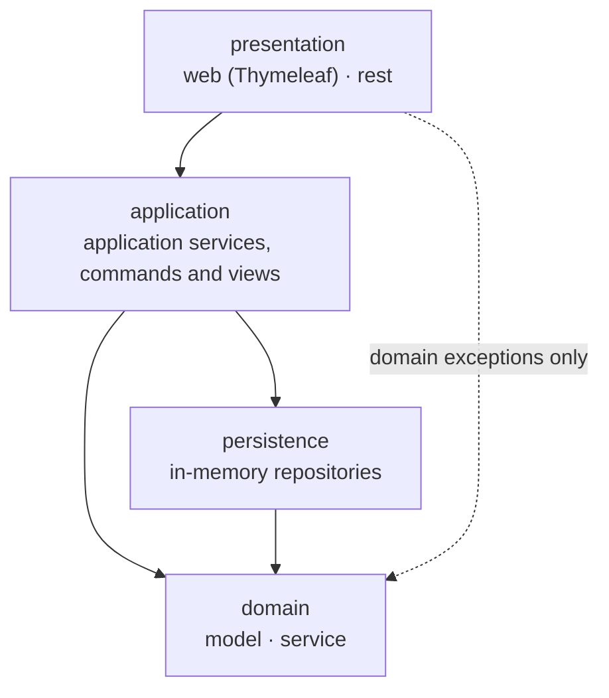
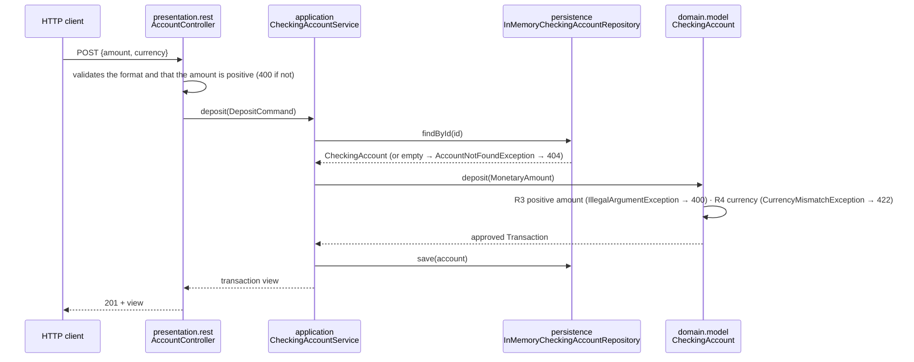

# Phase 1 · Layered monolith (`Monolithic` branch)

Design decided in [ADR 0004](../adr/0004-arquitectura-en-capas.md). The terms used here are the ones in the [glossary](../dominio/glosario.md). This is the **final state** of phase 1, frozen with the `v1-monolito` tag (#13); phase 2 continues on the `Hexagonal` branch.

## Layers



Arrows show **who depends on whom**: always downwards. `domain` sits at the bottom and depends on nothing. The dotted arrow is the only dependency from `presentation` on the domain: the exceptions it translates to HTTP or to messages (D4).

| Package | Responsibility | Contains |
| ------- | -------------- | -------- |
| `presentation.web` | Screens and forms: takes the input, calls a use case and renders the view | Spring MVC controllers, Thymeleaf templates, `WebSecurityConfig` |
| `presentation.rest` | REST API: translates HTTP ↔ commands/views, and errors to `ProblemDetail` from a single place | `@RestController`, DTOs, `@RestControllerAdvice`, `ApiSecurityConfig` |
| `presentation` (root) | What both channels share without knowing each other (D5) | `SecuritySupport`, `CurrentCaller`, `SecurityUsersProperties` |
| `application` | Use cases: loads aggregates, calls the domain, saves. **No business rules**; decides account ownership with the `Caller` | `CheckingAccountService`, commands and views (Immutables, `@ApplicationValue`), application errors, `DemoDataLoader` |
| `domain.model` | Model and business rules (R1-R19 of the glossary) | `CheckingAccount` aggregate, entities, value objects, domain exceptions |
| `domain.service` | Rules that span several aggregates | `MoneyTransferService` |
| `persistence` | Saving and loading aggregates | `InMemoryCheckingAccountRepository`, `InMemoryAccountOwnershipRepository` (concrete classes, simulated) |

## Dependencies

This table is the specification of [`LayeredArchitectureTests`](../../src/test/java/com/pronoide/ddd/LayeredArchitectureTests.java). Each row is an ArchUnit rule.

| # | Source | May depend on | May not depend on |
| - | ------ | ------------- | ----------------- |
| D1 | `..domain..` | the JDK only | `..application..`, `..persistence..`, `..presentation..`, `org.springframework..`, `jakarta..`, `org.immutables..` |
| D2 | `..persistence..` | `..domain..` | `..application..`, `..presentation..` |
| D3 | `..application..` | `..domain..`, `..persistence..` | `..presentation..` |
| D4 | `..presentation..` | `..application..`; from `..domain.model..` **only** `DomainException` and its subclasses (to translate them to HTTP or messages) | `..persistence..`, `..domain.service..` and the rest of `..domain.model..` (aggregates, entities, value objects): presentation works with commands and views, not with the model |
| D5 | `..presentation.web..` | — | `..presentation.rest..` (and the other way round: web and REST do not know each other) |

## ArchUnit rules

Each rule was validated by breaking it on purpose (red) and reverting (green).

| Rule | Covers | Issue |
| ---- | ------ | ----- |
| `las_capas_solo_dependen_hacia_abajo` (`layeredArchitecture()`) | D2, D3: nobody uses `presentation`, only `presentation` uses `application`, only `application` uses `persistence` | #12 |
| `el_dominio_solo_depende_del_jdk` | D1 (includes Spring, `jakarta` and `org.immutables`) | #12 |
| `la_presentacion_solo_conoce_las_excepciones_del_dominio` | D4 (from `domain`, only `DomainException` and its subclasses; no `domain.service`) | #12 |
| `la_web_y_rest_no_se_conocen` (`slices()`) | D5, both ways | #12 |
| `el_dominio_no_tiene_setters_publicos` | The domain only changes state through business methods | #12 |
| `los_controladores_no_acceden_al_repositorio` | Classes with `@Controller` or `@RestController` (meta-annotation) do not use `persistence`; overlaps with the layer rule, but its message is clearer | #12 |
| `toda_clase_pertenece_a_una_capa` | Only `DddLabApplication` lives outside the four layers: the layer rule ignores packages that are not layers, so a new package (`config`…) must be added as a layer first | #12 |
| `la_aplicacion_no_depende_de_spring_security` | ADR 0008: account ownership is decided with `Caller`, without Spring Security in `application` | #54 |
| `nadie_usa_la_seguridad_por_metodos` | ADR 0008: no class or method uses `@PreAuthorize`, `@PostAuthorize` or `@Secured`, in any layer | #54 |
| `la_persistencia_no_tiene_interfaces` | ADR 0004: concrete classes, no port interfaces in `persistence` (phase 1 only) | #54 |

[`DomainIsolationTests`](../../src/test/java/com/pronoide/ddd/DomainIsolationTests.java) adds `el_dominio_no_depende_del_framework` and `el_estado_del_dominio_esta_encapsulado` (private state). They are the rules that survive both phases. Lombok in the domain (ADR 0009) is checked by `check-domain.mjs`, because ArchUnit cannot see `SOURCE`-retention annotations.

## Example flow: a deposit

`POST /api/accounts/{id}/deposits`:



| Responsibility | Where it lives |
| -------------- | -------------- |
| Validating the request format | `presentation` |
| Loading and saving the aggregate | `application` (using `persistence`) |
| Deciding whether the caller owns the account | `application` (with the `Caller`) |
| Business rules (positive amount, currency, overdraft…) | `domain.model` |
| Translating errors to HTTP or screen messages | `presentation` (one place per channel) |

**Error translation.** Only subclasses of `DomainException` are business rules (422). Invalid arguments the domain rejects with `IllegalArgumentException` (non-positive amount, malformed IBAN) are **not** `DomainException`: presentation validates them before calling the use case, and if one still gets through it becomes a 400 validation error. `AccountNotFoundException` (application, subclass of `NotFoundException`) becomes a 404, also for someone else's account (#50).

## REST endpoints

The source of truth is [`openapi.yaml`](../api/openapi.yaml), linted with Redocly in CI. All endpoints use HTTP Basic, without session or CSRF; errors are `ProblemDetail` (RFC 9457) from [`RestExceptionHandler`](../../src/main/java/com/pronoide/ddd/presentation/rest/RestExceptionHandler.java).

| Method | Path | Role | Responses |
| ------ | ---- | ---- | --------- |
| `GET` | `/api/accounts` | any (a customer only sees their own accounts) | 200, 401 |
| `POST` | `/api/accounts` | `ADMIN` | 201, 400, 401, 403, 422 |
| `GET` | `/api/accounts/{id}` | owner or `ADMIN` | 200, 400, 401, 404 |
| `POST` | `/api/accounts/{id}/deposits` | owner or `ADMIN` | 201, 400, 401, 404, 422 |
| `POST` | `/api/accounts/{id}/withdrawals` | owner or `ADMIN` | 201 (also when rejected: `REJECTED`), 400, 401, 404, 422 |
| `POST` | `/api/transfers` | owner of the source account or `ADMIN` | 201 (also when rejected), 400, 401, 404, 422 |

## Screens

Thymeleaf over the [base layout fragments](../../src/main/resources/templates/fragments/layout.html), dark minimal theme in `static/css/app.css` (#48), amounts formatted by [`WebFormat`](../../src/main/java/com/pronoide/ddd/presentation/web/WebFormat.java).

| Route | What it shows | Role |
| ----- | ------------- | ---- |
| `/login` | Login form | public |
| `/` | Account list | any (a customer only sees their own) |
| `/accounts/new` (GET/POST) | Open an account (Post/Redirect/Get with a flash message) | `ADMIN` |
| `/accounts/{id}` | Account details: balance, transactions and the deposit, withdrawal and transfer forms (`<details>`; only the one with errors reopens) | owner or `ADMIN` |
| `POST /accounts/{id}/deposits`, `/withdrawals`, `/transfers` | The three operations; the transfer target is typed as an IBAN | owner or `ADMIN` |
| `/error/403`, 404 page | Access denied and not found (API routes keep answering JSON) | public |
| `/h2-console` | H2 console | `ADMIN` |

## Security

Decided in [ADR 0008](../adr/0008-spring-security.md) (#50, contract [`login-roles.md`](../contracts/login-roles.md)):

- **Authentication in `presentation`**, with one Spring Security chain per channel so back and web do not share a file: [`ApiSecurityConfig`](../../src/main/java/com/pronoide/ddd/presentation/rest/ApiSecurityConfig.java) (`/api/**`, HTTP Basic, 401/403 as `ProblemDetail`) and [`WebSecurityConfig`](../../src/main/java/com/pronoide/ddd/presentation/web/WebSecurityConfig.java) (fallback chain, form login, CSRF, 403 page).
- **Roles in the URLs (Spring), ownership in `application`:** only `ADMIN` opens accounts; who may touch which account is decided by `CheckingAccountService` with the `Caller` each use case receives, the same for both channels and tested without Spring. Someone else's account is a 404, not a 403, so its existence is not revealed.
- **Identity never reaches `domain`:** the owner of an account is a username stored in `persistence` (`InMemoryAccountOwnershipRepository`), outside the aggregate.

## How to run

```bash
./mvnw verify            # JUnit + ArchUnit
./mvnw spring-boot:run   # http://localhost:8080 · /actuator/health · /h2-console
```

`spring-boot:run` uses the `demo` profile: three demo accounts (two retail, one high net worth) and the users `admin`, `ada`, `grace` and `alan`, all with password `demo`. `-Dspring-boot.run.profiles=default` starts without data; then `APP_ADMIN_USERNAME` and `APP_ADMIN_PASSWORD` create an administrator.

## Features and decisions worth keeping

| Feature | Issue · PR | Decisions a phase 2 reader needs |
| ------- | ---------- | -------------------------------- |
| In-memory persistence | #4 · #35 | Concrete class, no interface (ADR 0004); phase 2 turns it into an output port (#15) |
| REST and web foundation | #8 · #36 | A single `@RestControllerAdvice`; REST DTOs may be Immutables with Jackson 3 (`tools.jackson.databind.annotation`, [ADR 0003](../adr/0003-lombok-immutables.md)) |
| Open, query and list accounts (team) | #5 · #39 | `DuplicateAccountNumberException` (R16) thrown by the service after asking the repository; the REST request and the web form apply the same validation, so nothing they accept triggers an `IllegalArgumentException`; session tracked by cookie only (with URL tracking the redirect went to `/;jsessionid=…` and returned 404) |
| Deposits and withdrawals (team) | #6 · #41 | A rejected withdrawal is a `REJECTED` transaction, not an exception; the web `@ControllerAdvice` is scoped with `basePackageClasses`, because `@RestController` also carries `@Controller` |
| Transfers (team) | #7 · #43 | `MoneyTransferService` is plain Java, created with `new` (no Spring bean, D1); the application service saves **both** accounts |
| Demo data | #11 · #45 | `DemoDataLoader` opens accounts through `CheckingAccountService`, never through the repository; test builder `TestAccounts` (`@Builder`, used without static import) |
| Layered ArchUnit rules | #12 · #47 | D1-D5 plus the rules in the table above |
| Dark minimal web | #48 · #49 | No JavaScript or new dependencies; `WebFormat` only receives values from views, never domain types (D4) |
| Login with roles | #50 · #51 | See [Security](#security) |
| Pending ADR rules | #54 · #56 | ADR 0004 and 0008 rules in ArchUnit |

## Issues of the phase

| Issue | Title | PR |
| ----- | ----- | -- |
| #2 | Configure Lombok and Immutables in the build | #24 |
| #3 | Document the glossary and the layered architecture | #33, #34 |
| #4 | In-memory persistence of checking accounts | #35 |
| #8 | REST and web foundation: centralised errors, layout and OpenAPI | #36 |
| #31 | Back/web team flow, contract first | #32, #39 |
| #5 | Open, query and list accounts (back + web) | #39 |
| #9 | Web: list and open accounts | not planned (merged into #5) |
| #6 | Deposits and withdrawals with account details (back + web) | #41 |
| #10 | Web: account details, transactions and operations | not planned (merged into #6) |
| #7 | Transfers between accounts (back + web) | #43 |
| #11 | Demo data on startup | #45 |
| #12 | ArchUnit rules for the layered architecture | #47 |
| #48 | Dark minimal web redesign | #49 |
| #50 | Login with admin and user roles (Spring Security) | #51 |
| #54 | Pending ADR ArchUnit rules and `DomainIsolationTests` cleanup | #56 |
| #57 | Graphify to reduce token usage | #58 |
| #13 | Close phase 1: final documentation and `v1-monolito` tag | this PR |

Issues marked *team* were implemented with `/implement-plan-team` (contract first, ADR 0007).
