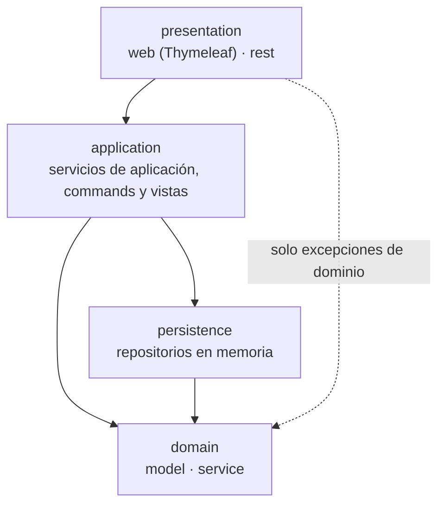
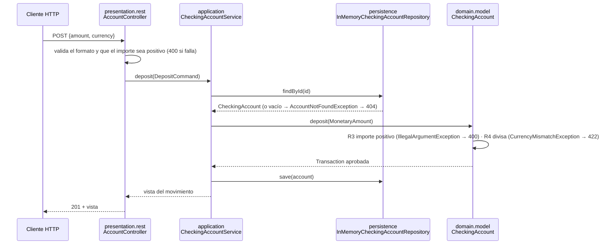

# Fase 1 · Monolito en capas (rama `Monolithic`)

Diseño objetivo de la fase 1, decidido en el [ADR 0004](../adr/0004-arquitectura-en-capas.md). Los términos usados aquí son los del [glosario](../dominio/glosario.md). Se completa con el estado real al cerrar la fase (#13).

## Capas

Las flechas indican **quién depende de quién**: siempre hacia abajo. `domain` está en el fondo y no depende de nada. La flecha punteada es la única dependencia de `presentation` con el dominio: las excepciones que traduce a HTTP o a mensajes (D4).

| Paquete | Responsabilidad | Contiene |
| ------- | --------------- | -------- |
| `presentation.web` | Pantallas y formularios: recoge la entrada, llama a un caso de uso y pinta la vista | Controladores Spring MVC, plantillas Thymeleaf |
| `presentation.rest` | API REST: traduce HTTP ↔ commands/vistas y los errores a `ProblemDetail` desde un único punto | `@RestController`, DTOs, `@RestControllerAdvice` |
| `application` | Casos de uso: carga agregados, invoca al dominio, guarda. **Sin reglas de negocio** | Servicios de aplicación, commands y vistas (Immutables, `@ApplicationValue`), errores de aplicación |
| `domain.model` | Modelo y reglas de negocio (R1-R15 del glosario) | Agregado `CheckingAccount`, entidades, objetos de valor, excepciones de dominio |
| `domain.service` | Reglas que abarcan varios agregados | `MoneyTransferService` (#7) |
| `persistence` | Guardar y recuperar agregados | `InMemoryCheckingAccountRepository` (clase concreta, simulada) |

## Dependencias

Esta tabla es la especificación de `LayeredArchitectureTests` (#12). Cada fila es una regla de ArchUnit.

| # | Origen | Puede depender de | No puede depender de |
| - | ------ | ----------------- | -------------------- |
| D1 | `..domain..` | solo el JDK | `..application..`, `..persistence..`, `..presentation..`, `org.springframework..`, `jakarta..`, `org.immutables..` |
| D2 | `..persistence..` | `..domain..` | `..application..`, `..presentation..` |
| D3 | `..application..` | `..domain..`, `..persistence..` | `..presentation..` |
| D4 | `..presentation..` | `..application..`; de `..domain.model..` **solo** `DomainException` y sus subclases (para traducirlas a HTTP o a mensajes) | `..persistence..`, `..domain.service..` y el resto de `..domain.model..` (agregados, entidades, objetos de valor): la presentación trabaja con commands y vistas, no con el modelo |
| D5 | `..presentation.web..` | — | `..presentation.rest..` (y al revés: la web y REST no se conocen) |

Además, ya existen y se mantienen: el dominio no depende del framework y su estado es privado (`DomainIsolationTests`).

## Ejemplo de flujo: un ingreso

`POST /api/accounts/{id}/deposits` (ruta definida en #6):

| Responsabilidad | Dónde vive |
| --------------- | ---------- |
| Validar el formato de la petición | `presentation` |
| Cargar y guardar el agregado | `application` (usando `persistence`) |
| Reglas de negocio (importe positivo, divisa, descubierto…) | `domain.model` |
| Traducir errores a HTTP o a mensajes de pantalla | `presentation` (un único punto por canal) |

**Traducción de errores.** Solo las subclases de `DomainException` son reglas de negocio (422). Los argumentos inválidos que el dominio rechaza con `IllegalArgumentException` (importe no positivo, IBAN mal formado) **no** son `DomainException`: la presentación los valida antes de llamar al caso de uso, y si aun así llegan, se traducen a 400 como error de validación. `AccountNotFoundException` (aplicación, subclase de `NotFoundException`) se traduce a 404.

Implementado en la #8:

- API REST: [`RestExceptionHandler`](../../src/main/java/com/pronoide/ddd/presentation/rest/RestExceptionHandler.java), único `@RestControllerAdvice`, devuelve `ProblemDetail` (RFC 9457). Las respuestas están documentadas en [`openapi.yaml`](../api/openapi.yaml) (`BadRequest`, `NotFound`, `UnprocessableContent`) y el CI las valida con Redocly.
- Web: [página 404 propia](../../src/main/resources/templates/error/404.html) sobre los [fragmentos de la plantilla base](../../src/main/resources/templates/fragments/layout.html). Las rutas de la API siguen respondiendo en JSON.
- **DTOs REST:** pueden ser de Immutables con Jackson 3 (`@JsonSerialize`/`@JsonDeserialize` de `tools.jackson.databind.annotation`); ver el [ADR 0003](../adr/0003-lombok-immutables.md).

Implementado en la #5 (contrato: [`open-query-list-accounts.md`](../contracts/open-query-list-accounts.md)):

- `application`: [`CheckingAccountService`](../../src/main/java/com/pronoide/ddd/application/CheckingAccountService.java) (abrir, consultar y listar), `OpenAccountCommand`, las vistas `AccountSummary`, `AccountDetails` y `TransactionSummary`, y `AccountNotFoundException`.
- `domain.model`: `DuplicateAccountNumberException` (R16), lanzada por el servicio tras consultar el repositorio.
- `presentation.rest`: `AccountController` (`/api/accounts`), con la petición como `record` con Bean Validation y las respuestas como DTOs de Immutables.
- `presentation.web`: listado en `/` y alta en `/accounts/new` (Post/Redirect/Get con mensaje flash). La sesión se sigue solo por cookie (`server.servlet.session.tracking-modes=cookie`): con seguimiento por URL, la redirección iba a `/;jsessionid=…` y Spring respondía 404.
- La petición REST y el formulario aplican la misma validación, para que lo que aceptan nunca provoque un `IllegalArgumentException` del dominio.

Implementado en la #6 (contrato: [`deposits-withdrawals.md`](../contracts/deposits-withdrawals.md)):

- `application`: `CheckingAccountService.deposit` y `withdraw`, con `DepositCommand` y `WithdrawCommand`; devuelven el movimiento (`TransactionSummary`). Una retirada no permitida se devuelve como `REJECTED`, no como excepción.
- `presentation.rest`: `POST /api/accounts/{id}/deposits` y `/withdrawals` (201 con el movimiento, también si se rechaza).
- `presentation.web`: detalle de la cuenta en `/accounts/{id}` con sus movimientos y los formularios de ingreso y retirada. Un `@ControllerAdvice` acotado al paquete `presentation.web` (`basePackageClasses`) pinta la página 404 para `NotFoundException`; no se acota por `@Controller` porque `@RestController` también la lleva y capturaría los errores de la API.
- Un importe no positivo es un 400 o un error de campo (R3), no un error de dominio; solo la divisa distinta es 422.

Implementado en la #7 (contrato: [`money-transfers.md`](../contracts/money-transfers.md)):

- `domain.service`: [`MoneyTransferService`](../../src/main/java/com/pronoide/ddd/domain/service/MoneyTransferService.java), primer servicio de dominio, Java puro y sin estado (R17-R19). `CheckingAccountService` lo crea con `new`, sin bean de Spring, para que el dominio no dependa del framework (D1).
- `domain.model`: `SameAccountTransferException` (R17).
- `application`: `CheckingAccountService.transfer` con `TransferCommand` y la vista `TransferSummary`; carga las dos cuentas, delega en el servicio de dominio y **guarda las dos**.
- `presentation.rest`: `TransferController` (`POST /api/transfers`, 201 también si se rechaza).
- `presentation.web`: formulario de transferencia en el detalle de la cuenta, con la cuenta destino elegida entre las demás (`listAccounts()`); la presentación no conoce `domain.service` (D4).

## Issues de la fase

| Orden | Issue | Capas | Clases que introduce |
| ----- | ----- | ----- | -------------------- |
| 1 | #3 (esta documentación) | docs | — |
| 2 | #4 Persistencia en memoria | `persistence` | `InMemoryCheckingAccountRepository` |
| 3 | #8 Base de REST y web | `presentation.rest`, `presentation.web` | `@RestControllerAdvice`, plantilla base, página 404, `openapi.yaml` inicial |
| 4 | #5 Abrir, consultar y listar cuentas (equipo) | `application`, `presentation.rest`, `presentation.web` | `CheckingAccountService`, `OpenAccountCommand`, `AccountSummary`, `AccountDetails`, `AccountNotFoundException` |
| 5 | #6 Ingresos y retiradas (equipo) | `application`, `presentation.rest`, `presentation.web` | `DepositCommand`, `WithdrawCommand`, vista del movimiento |
| 6 | #7 Transferencias (equipo) | `domain.service`, `application`, `presentation.rest`, `presentation.web` | `MoneyTransferService`, `TransferCommand` |
| 7 | #11 Datos de demostración | `application` | `ApplicationRunner` con perfil `demo` |
| 8 | #12 Reglas de ArchUnit | tests | `LayeredArchitectureTests` (reglas D1-D5) |
| 9 | #13 Cierre de la fase | docs | etiqueta `v1-monolito`, rama `Hexagonal` |

Las issues marcadas como *equipo* se implementan con `/implement-plan-team` (contrato primero, ADR 0007).
