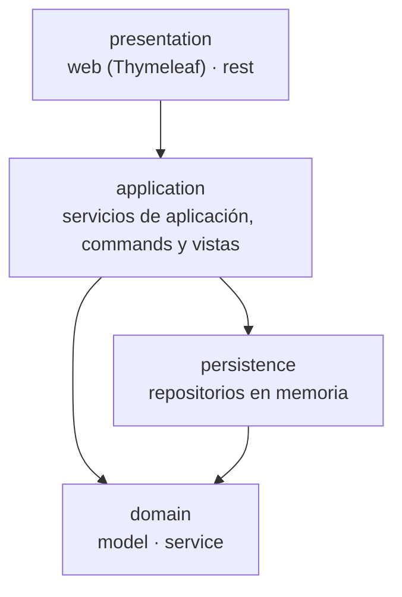
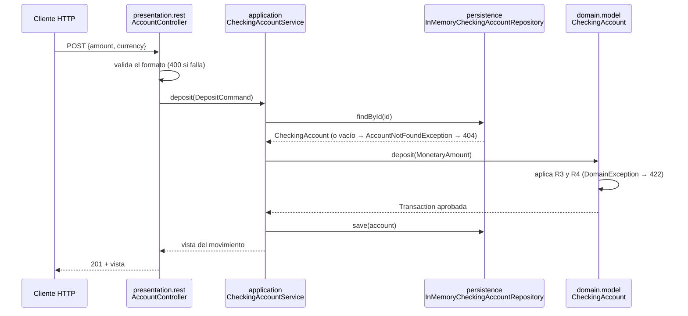

# Fase 1 · Monolito en capas (rama `Monolithic`)

Diseño objetivo de la fase 1, decidido en el [ADR 0004](../adr/0004-arquitectura-en-capas.md). Los términos usados aquí son los del [glosario](../dominio/glosario.md). Se completa con el estado real al cerrar la fase (#13).

## Capas

Las flechas indican **quién depende de quién**: siempre hacia abajo. `domain` está en el fondo y no depende de nada.

| Paquete | Responsabilidad | Contiene |
| ------- | --------------- | -------- |
| `presentation.web` | Pantallas y formularios: recoge la entrada, llama a un caso de uso y pinta la vista | Controladores Spring MVC, plantillas Thymeleaf |
| `presentation.rest` | API REST: traduce HTTP ↔ commands/vistas y los errores a `ProblemDetail` desde un único punto | `@RestController`, DTOs, `@RestControllerAdvice` |
| `application` | Casos de uso: carga agregados, invoca al dominio, guarda. **Sin reglas de negocio** | Servicios de aplicación, commands y vistas (Immutables, `@ApplicationValue`), errores de aplicación |
| `domain.model` | Modelo y reglas de negocio (R1-R15 del glosario) | Agregado `CheckingAccount`, entidades, objetos de valor, excepciones de dominio |
| `domain.service` | Reglas que abarcan varios agregados | `MoneyTransferService` (#7) |
| `persistence` | Guardar y recuperar agregados | `InMemoryCheckingAccountRepository` (clase concreta, simulada) |

## Dependencias

Esta tabla es la especificación de `LayeredArchitectureTests` (#12). Cada fila es una regla de ArchUnit.

| # | Origen | Puede depender de | No puede depender de |
| - | ------ | ----------------- | -------------------- |
| D1 | `..domain..` | solo el JDK | `..application..`, `..persistence..`, `..presentation..`, `org.springframework..`, `jakarta..`, `org.immutables..` |
| D2 | `..persistence..` | `..domain..` | `..application..`, `..presentation..` |
| D3 | `..application..` | `..domain..`, `..persistence..` | `..presentation..` |
| D4 | `..presentation..` | `..application..` | `..persistence..` |
| D5 | `..presentation.web..` | — | `..presentation.rest..` (y al revés: la web y REST no se conocen) |
| D6 | `..presentation..` | `..domain.model..` solo para las excepciones de dominio que traduce a HTTP o a mensajes | agregados y entidades: la presentación trabaja con vistas, no con el modelo |

Además, ya existen y se mantienen: el dominio no depende del framework y su estado es privado (`DomainIsolationTests`).

## Ejemplo de flujo: un ingreso

`POST /api/accounts/{id}/deposits` (ruta definida en #6):

| Responsabilidad | Dónde vive |
| --------------- | ---------- |
| Validar el formato de la petición | `presentation` |
| Cargar y guardar el agregado | `application` (usando `persistence`) |
| Reglas de negocio (importe positivo, divisa, descubierto…) | `domain.model` |
| Traducir errores a HTTP o a mensajes de pantalla | `presentation` (un único punto por canal) |

## Issues de la fase

| Orden | Issue | Capas | Clases que introduce |
| ----- | ----- | ----- | -------------------- |
| 1 | #3 (esta documentación) | docs | — |
| 2 | #4 Persistencia en memoria | `persistence` | `InMemoryCheckingAccountRepository` |
| 3 | #8 Base de REST y web | `presentation.rest`, `presentation.web` | `@RestControllerAdvice`, plantilla base, página 404, `openapi.yaml` inicial |
| 4 | #5 Abrir, consultar y listar cuentas (equipo) | `application`, `presentation.rest`, `presentation.web` | `CheckingAccountService`, `OpenAccountCommand`, `AccountSummary`, `AccountDetails`, `AccountNotFoundException` |
| 5 | #6 Ingresos y retiradas (equipo) | `application`, `presentation.rest`, `presentation.web` | `DepositCommand`, `WithdrawCommand`, vista del movimiento |
| 6 | #7 Transferencias (equipo) | `domain.service`, `application`, `presentation.rest`, `presentation.web` | `MoneyTransferService`, `TransferCommand` |
| 7 | #11 Datos de demostración | `application` | `ApplicationRunner` con perfil `demo` |
| 8 | #12 Reglas de ArchUnit | tests | `LayeredArchitectureTests` (reglas D1-D6) |
| 9 | #13 Cierre de la fase | docs | etiqueta `v1-monolito`, rama `Hexagonal` |

Las issues marcadas como *equipo* se implementan con `/implement-plan-team` (contrato primero, ADR 0007).
