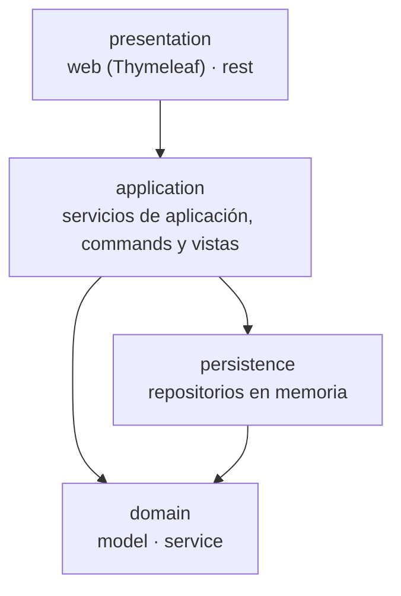

# Fase 1 · Monolito en capas (rama `Monolithic`)

> Diseño objetivo. Se completa con el estado real al cerrar la fase (última issue del milestone).

## Capas

| Paquete | Responsabilidad | Puede usar |
| ------- | --------------- | ---------- |
| `presentation.web` | Pantallas Thymeleaf y formularios | `application` |
| `presentation.rest` | API REST y traducción de errores a HTTP | `application` |
| `application` | Casos de uso: cargar, invocar el dominio, guardar; commands y vistas con Immutables | `domain`, `persistence` |
| `domain.model` | Agregado `CheckingAccount`, entidades, objetos de valor, excepciones | nada |
| `domain.service` | `MoneyTransferService` | `domain.model` |
| `persistence` | `InMemoryCheckingAccountRepository` (clase concreta, simulada) | `domain` |

## Decisiones

- **Sin interfaces de repositorio**: la aplicación usa la clase concreta de persistencia. Es el rasgo que diferencia esta fotografía de la hexagonal, donde el dominio declarará el puerto.
- El dominio no depende de ninguna capa ni de Spring (`DomainIsolationTests`).
- Se acepta que `application` use `persistence` directamente (el "bypass entre capas" del capítulo 18.1 del curso), evitando un *layer cake* en el que el dominio solo reenviara llamadas.

Ver el [ADR 0004](../adr/README.md) (se escribe en la issue de documentación de la fase 1).
