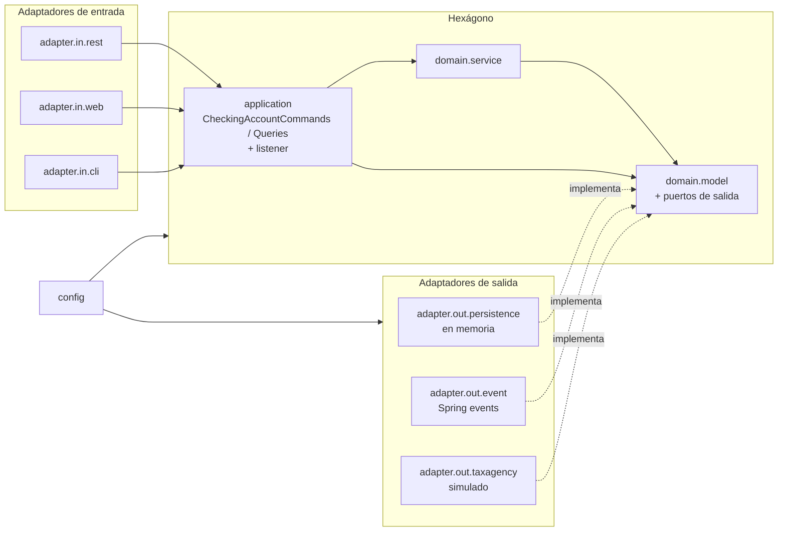

# Fase 2 · Arquitectura hexagonal (rama `Hexagonal`)

> Diseño objetivo basado en el Lab 27 del curso de DDD. Se completa al cerrar la fase.



## Estructura de paquetes

```
com.pronoide.ddd
├── adapter
│   ├── in
│   │   ├── cli           DomainModelRunner
│   │   ├── rest          API REST
│   │   └── web           Thymeleaf
│   └── out
│       ├── event         SpringDomainEventPublisher
│       ├── persistence   InMemoryCheckingAccountRepository, InMemoryAccountNumberSequence
│       └── taxagency     FakeTaxAgencyIncomeVerifier
├── application           servicios de aplicación y puertos de entrada
│   └── listener          consumidores de eventos de dominio
├── config                DomainConfiguration
└── domain
    ├── model             modelo y puertos de salida
    └── service           MoneyTransferService
```

## Reglas

| | Lado de entrada | Lado de salida |
| - | - | - |
| Puerto | `application` (lo que la aplicación ofrece) | `domain.model` (lo que necesita) |
| Adaptador | usa el puerto | implementa el puerto |

- Las dependencias apuntan siempre hacia el hexágono; los adaptadores no se conocen entre sí.
- El núcleo no lleva anotaciones de Spring: `config` lo construye y le entrega sus adaptadores.
- Todos los adaptadores de salida son simulados (en memoria / ficticios), lo que basta para demostrar la arquitectura.
- Verificado por `HexagonalArchitectureTests` (ArchUnit).
