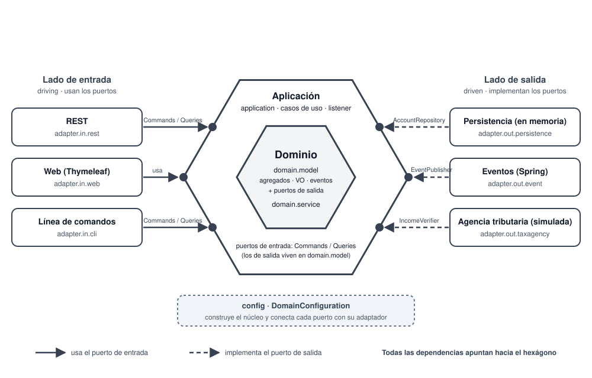

# Phase 2 · Hexagonal architecture (`Hexagonal` branch)



The domain sits in the centre; the application surrounds it and exposes the input ports. Adapters on the left **use** those ports, and adapters on the right **implement** the output ports the domain declares: on both sides the dependency points inwards. Decided in [ADR 0006](../adr/0006-hexagonal-architecture.md).

## Package structure

Target at the end of the phase:

```
com.pronoide.ddd
├── adapter
│   ├── in
│   │   ├── cli           DomainModelRunner
│   │   ├── rest          REST API
│   │   └── web           Thymeleaf
│   └── out
│       ├── event         SpringDomainEventPublisher
│       ├── persistence   InMemoryCheckingAccountRepository, InMemoryAccountNumberSequence
│       └── taxagency     FakeTaxAgencyIncomeVerifier
├── application           application services and input ports
│   └── listener          domain event consumers
├── config                DomainConfiguration
└── domain
    ├── model             model and output ports
    └── service           MoneyTransferService
```

## Rules

| | Input side | Output side |
| - | - | - |
| Port | `application` (what the application offers) | `domain.model` (what it needs) |
| Adapter | uses the port | implements the port |

- Dependencies always point into the hexagon; adapters do not know each other.
- The core carries no Spring annotations: `config` builds it and hands it its adapters.
- Every output adapter is simulated (in memory / fake), which is enough to show the architecture.
- Checked by `HexagonalArchitectureTests` (ArchUnit, #22). Until then, `LayeredArchitectureTests` with its patterns adjusted to the new packages (#14).

## Class → role

State after #15 (packages moved, persistence behind its output ports). The last column says which issue changes the class's role.

| Class | Package | Role in the architecture | Changes in |
| ----- | ------- | ------------------------ | ---------- |
| `AccountController`, `TransferController` | `adapter.in.rest` | Input adapter (REST): HTTP ↔ commands and views | #16: depend on the input ports only |
| `RestExceptionHandler` | `adapter.in.rest` | Input adapter: domain and application errors → `ProblemDetail` | — |
| `OpenAccountRequest`, `MovementRequest`, `TransferRequest`, `*ResponseDef` | `adapter.in.rest` | REST DTOs (records with Bean Validation, Immutables responses) | #18: the open-account request changes |
| `ApiSecurityConfig` | `adapter.in.rest` | Input adapter: security chain of `/api/**` (HTTP Basic) | — |
| `AccountWebController`, `LoginController`, `AccessDeniedController` | `adapter.in.web` | Input adapter (web): screens and forms | #16: depend on the input ports only |
| `MovementForm`, `OpenAccountForm`, `TransferForm` | `adapter.in.web` | Web forms | #18: the open-account form changes |
| `WebExceptionHandler`, `WebModelAdvice`, `WebFormat` | `adapter.in.web` | Web support: 404 page, common model attributes, amount formatting | — |
| `WebSecurityConfig` | `adapter.in.web` | Input adapter: fallback security chain (form login) | — |
| `SecuritySupport`, `CurrentCaller`, `SecurityUsersProperties` | `adapter.in` | Support shared by the input adapters: authenticated user → `Caller` | — |
| `InMemoryCheckingAccountRepository` | `adapter.out.persistence` | Output adapter (simulated persistence, package-private): implements `CheckingAccountRepository` | #20: wired in `config` |
| `InMemoryAccountOwnershipRepository` | `adapter.out.persistence` | Output adapter (package-private): implements `AccountOwnershipRepository`, which user owns each account (ADR 0008) | #20: wired in `config` |
| `CheckingAccountService` | `application` | Application service: use cases and account ownership; uses the output ports only | #16: implements `CheckingAccountCommands`/`Queries`; #17 publishes events; #20 built in `config` |
| `AccountOwnershipRepository` | `application` | Output port: account ownership. In `application`, not `domain.model`, because the user's identity never reaches the domain (ADR 0008) | — |
| `*CommandDef`, `*SummaryDef`, `AccountDetailsDef`, `CallerDef`, `ApplicationValue`, `CommandValidation` | `application` | Commands, views and `Caller` (Immutables) and their validation | #18: `OpenAccountCommand` changes |
| `NotFoundException`, `AccountNotFoundException`, `TargetAccountNotFoundException`, `ForbiddenOperationException`, `OperationNotAllowedException` | `application` | Application errors | — |
| `DemoDataLoader` | `application` | Demo data with the `demo` profile | #19: becomes the CLI input adapter `DomainModelRunner` |
| `CheckingAccount` | `domain.model` | Aggregate root | #17: records domain events; #18: opened only through the factory |
| `CheckingAccountRepository` | `domain.model` | Output port: repository of the aggregate | — |
| `AccountHolder`, `Transaction` | `domain.model` | Entities | — |
| `AccountNumber`, `MonetaryAmount` | `domain.model` | Value objects | — |
| `CustomerSegment`, `TransactionStatus`, `TransactionType` | `domain.model` | Domain enumerations | #18: the segment is decided by the factory |
| `DomainException` and its subclasses (`CurrencyMismatchException`, `DuplicateAccountNumberException`, `InsufficientInitialDepositException`, `SameAccountTransferException`) | `domain.model` | Business rule violations (422) | — |
| `MoneyTransferService` | `domain.service` | Domain service (transfers, R17-R19) | #20: built in `config` |
| `DddLabApplication` | root | Spring Boot entry point | — |

Classes that arrive later: output ports `AccountNumberSequence` and `IncomeVerifier` (#18) and `DomainEventPublisher` (#17) in `domain.model`; input ports `CheckingAccountCommands` and `CheckingAccountQueries` (#16) in `application`; `CheckingAccountFactory` (#18); adapters `InMemoryAccountNumberSequence`, `FakeTaxAgencyIncomeVerifier` (#18), `SpringDomainEventPublisher` (#17) and `DomainModelRunner` (#19); listeners in `application.listener` (#17); `DomainConfiguration` (#20).
