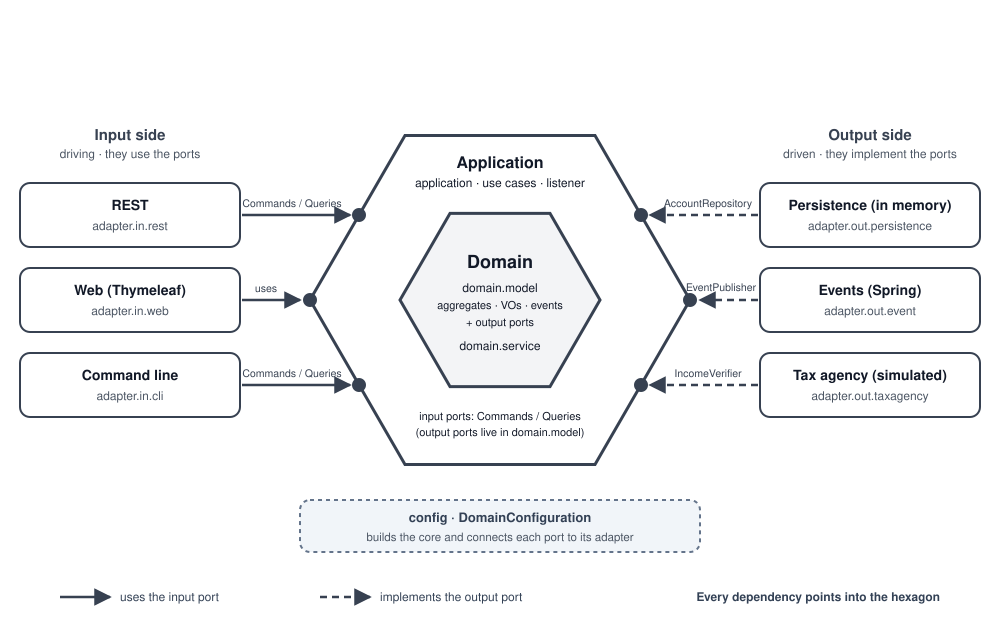

# Phase 2 · Hexagonal architecture (`Hexagonal` branch)



The domain sits in the centre; the application surrounds it and exposes the input ports. Adapters on the left **use** those ports, and adapters on the right **implement** the output ports the domain declares: on both sides the dependency points inwards. Decided in [ADR 0006](../adr/0006-hexagonal-architecture.md).

## Package structure

Target at the end of the phase:

```
com.pronoide.ddd
├── adapter
│   ├── in
│   │   ├── cli           DomainModelRunner
│   │   ├── rest          REST API
│   │   └── web           Thymeleaf
│   └── out
│       ├── event         SpringDomainEventPublisher
│       ├── persistence   InMemoryCheckingAccountRepository, InMemoryAccountNumberSequence
│       └── taxagency     FakeTaxAgencyIncomeVerifier
├── application           application services and input ports
│   └── listener          domain event consumers
├── config                DomainConfiguration
└── domain
    ├── model             model and output ports
    └── service           MoneyTransferService
```

## Rules

| | Input side | Output side |
| - | - | - |
| Port | `application` (what the application offers) | `domain.model` (what it needs) |
| Adapter | uses the port | implements the port |

- Dependencies always point into the hexagon; adapters do not know each other.
- The core carries no Spring annotations: `config` builds it and hands it its adapters, which it receives by their port types (it imports no class of `adapter.out`). The only exception is `@EventListener` on the event consumers.
- Every output adapter is simulated (in memory / fake), which is enough to show the architecture.
- Checked by `HexagonalArchitectureTests` (ArchUnit, #22). Until then, `LayeredArchitectureTests` with its patterns adjusted to the new packages (#14).

## How adapters are tested

Each adapter is tested without the hexagon (#21). `AdapterTestIsolationTests` (ArchUnit over the test code) forbids `@SpringBootTest` in any input-adapter test; the full-context tests live in the root package (`DddLabApplicationTests`, `DemoProfileTests`).

| Adapter | How | Test class |
| ------- | --- | ---------- |
| REST controllers | `@WebMvcTest` with `CheckingAccountCommands`/`CheckingAccountQueries` mocked (`@MockitoBean`) | `AccountControllerTests`, `TransferControllerTests`, `RestExceptionHandlerTests` |
| Web controllers | `@WebMvcTest` with the ports mocked | `AccountWebControllerTests`, `WebSecurityTests` |
| CLI runner | the real application service with in-memory adapters, without Spring | `DomainModelRunnerTests` |
| Persistence | port contracts (`*Contract`) extended by the in-memory adapter's test | `InMemoryCheckingAccountRepositoryTests`, `InMemoryAccountOwnershipRepositoryTests`, `InMemoryAccountNumberSequenceTests` |
| Events | a minimal Spring context with only the adapter and a recording `@EventListener`; plus a unit test with a mocked `ApplicationEventPublisher` | `SpringDomainEventPublisherContextTests`, `SpringDomainEventPublisherTests` |
| Tax agency | the fake on its own | `FakeTaxAgencyIncomeVerifierTests` |

Error paths of every endpoint, all with the ports mocked:

| Endpoint | 404 | 422 | 400 |
| -------- | --- | --- | --- |
| `POST /api/accounts` | n/a | minimum deposit, duplicate number | field errors, malformed JSON (and 403 for non-admins) |
| `GET /api/accounts` | n/a | n/a | n/a (no error path) |
| `GET /api/accounts/{id}` | unknown or not owned | n/a | malformed UUID |
| `POST /api/accounts/{id}/deposits`, `/withdrawals` | unknown or not owned | currency | amount, currency |
| `POST /api/transfers` | source and target | same account, currency | IBAN, amount |
| Web screens (detail, movements, transfers, open account) | custom 404 page | form with the domain message | form with the field error (and 403 page) |

## Class → role

State after #20 (adapters behind input and output ports, domain events published after saving, accounts opened through the factory, demo data as a CLI input adapter, core built in `config` without Spring annotations). The last column says which issue changes the class's role.

| Class | Package | Role in the architecture | Changes in |
| ----- | ------- | ------------------------ | ---------- |
| `AccountController`, `TransferController` | `adapter.in.rest` | Input adapter (REST): HTTP ↔ commands and views; uses the input ports only | — |
| `RestExceptionHandler` | `adapter.in.rest` | Input adapter: domain and application errors → `ProblemDetail` | — |
| `OpenAccountRequest`, `MovementRequest`, `TransferRequest`, `*ResponseDef` | `adapter.in.rest` | REST DTOs (records with Bean Validation, Immutables responses); the open-account request carries the holder's NIF | — |
| `ApiSecurityConfig` | `adapter.in.rest` | Input adapter: security chain of `/api/**` (HTTP Basic) | — |
| `AccountWebController`, `LoginController`, `AccessDeniedController` | `adapter.in.web` | Input adapter (web): screens and forms; uses the input ports only | — |
| `MovementForm`, `OpenAccountForm`, `TransferForm` | `adapter.in.web` | Web forms; the open-account form asks for the holder's NIF | — |
| `WebExceptionHandler`, `WebModelAdvice`, `WebFormat` | `adapter.in.web` | Web support: 404 page, common model attributes, amount formatting | — |
| `WebSecurityConfig` | `adapter.in.web` | Input adapter: fallback security chain (form login) | — |
| `SecuritySupport`, `CurrentCaller`, `SecurityUsersProperties` | `adapter.in` | Support shared by the input adapters: authenticated user → `Caller` | — |
| `InMemoryCheckingAccountRepository` | `adapter.out.persistence` | Output adapter (simulated persistence, package-private): implements `CheckingAccountRepository` | — (component-scanned; `config` receives it by its port) |
| `SpringDomainEventPublisher` | `adapter.out.event` | Output adapter (package-private): implements `DomainEventPublisher` over Spring's `ApplicationEventPublisher` | — (component-scanned; `config` receives it by its port) |
| `InMemoryAccountNumberSequence` | `adapter.out.persistence` | Output adapter (simulated, package-private): implements `AccountNumberSequence`, valid consecutive Spanish IBANs | — (component-scanned; `config` receives it by its port) |
| `FakeTaxAgencyIncomeVerifier` | `adapter.out.taxagency` | Output adapter (simulated, package-private): implements `IncomeVerifier` with a fixed table | — (component-scanned; `config` receives it by its port) |
| `InMemoryAccountOwnershipRepository` | `adapter.out.persistence` | Output adapter (package-private): implements `AccountOwnershipRepository`, which user owns each account (ADR 0008) | — (component-scanned; `config` receives it by its port) |
| `CheckingAccountService` | `application` | Application service: implements `CheckingAccountCommands` and `CheckingAccountQueries` (use cases and account ownership); uses the output ports only, opens accounts through `CheckingAccountFactory` and publishes each account's domain events after saving it. Keeps its name (not `CheckingAccountApplicationService`): nobody outside `application` sees it. No Spring annotations: built in `config` | — |
| `CheckingAccountCommands`, `CheckingAccountQueries` | `application` | Input ports: use cases that change accounts (open, deposit, withdraw, transfer) and that query them (list, detail) | — |
| `AccountOwnershipRepository` | `application` | Output port: account ownership. In `application`, not `domain.model`, because the user's identity never reaches the domain (ADR 0008) | — |
| `*CommandDef`, `*SummaryDef`, `AccountDetailsDef`, `CallerDef`, `ApplicationValue`, `CommandValidation` | `application` | Commands, views and `Caller` (Immutables) and their validation | — |
| `AuditLogListener`, `CustomerNotificationListener` | `application.listener` | Domain event consumers: audit log and simulated customer notification. Declared in `config`; they keep `@EventListener`, the only Spring dependency allowed in the core (events reach them through Spring) | — |
| `NotFoundException`, `AccountNotFoundException`, `TargetAccountNotFoundException`, `ForbiddenOperationException`, `OperationNotAllowedException` | `application` | Application errors | — |
| `DomainModelRunner` | `adapter.in.cli` | Input adapter (CLI): with the `demo` profile, opens the demo accounts and runs a deposit, two withdrawals (approved and rejected) and a transfer through `CheckingAccountCommands`, with a `[demo]` trace per use case | — |
| `CheckingAccount` | `domain.model` | Aggregate root; records its domain events (`pullDomainEvents`); `open` is package-private, used only by the factory | — |
| `CheckingAccountFactory` | `domain.model` | Factory: number + segment from the verified income (R20); built in `config` | — |
| `AccountNumberSequence`, `IncomeVerifier` | `domain.model` | Output ports: account numbering and income verification | — |
| `DomainEvent`, `CheckingAccountOpened`, `MoneyDeposited`, `MoneyWithdrawn`, `WithdrawalRejected` | `domain.model` | Domain events (`record`) | — |
| `DomainEventPublisher` | `domain.model` | Output port: publishes domain events | — |
| `CheckingAccountRepository` | `domain.model` | Output port: repository of the aggregate | — |
| `AccountHolder`, `Transaction` | `domain.model` | Entities | — |
| `AccountNumber`, `MonetaryAmount`, `TaxId` | `domain.model` | Value objects | — |
| `CustomerSegment`, `TransactionStatus`, `TransactionType` | `domain.model` | Domain enumerations; the segment is decided by the factory | — |
| `DomainException` and its subclasses (`CurrencyMismatchException`, `DuplicateAccountNumberException`, `InsufficientInitialDepositException`, `SameAccountTransferException`) | `domain.model` | Business rule violations (422) | — |
| `MoneyTransferService` | `domain.service` | Domain service (transfers, R17-R19); built in `config` | — |
| `DomainConfiguration` | `config` | `@Configuration` that builds the core (`MoneyTransferService`, `CheckingAccountFactory`, `CheckingAccountService`, the listeners) and hands it the output adapters by their ports | — |
| `DddLabApplication` | root | Spring Boot entry point | — |

All the classes of the target design are in place; #21 and #22 add tests and `HexagonalArchitectureTests`.
