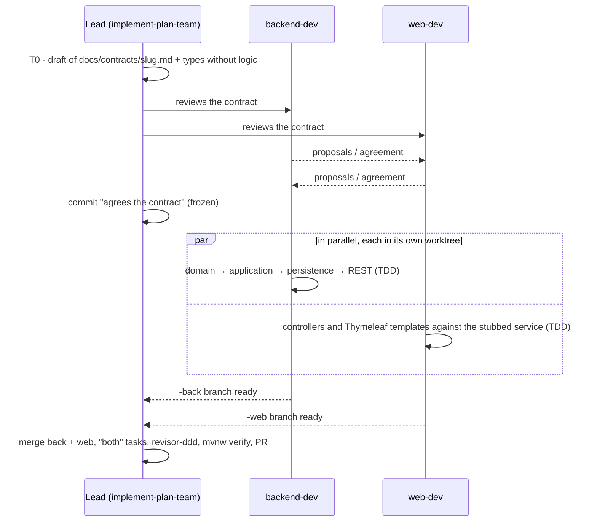

# AI architecture of the project

How this repository applies what was learned in the *Claude Code for software development* course. It adapts the architecture of [curso-claude](https://github.com/dawnrock/curso-claude) (Node/Express/Angular) to a Java 21 + Spring Boot project with DDD.

## Map of the pieces

```mermaid
flowchart LR
    I[GitHub issue<br/>phase milestone] -->|/plan-feature N| P[docs/plans/*.md<br/>+ comment on the issue]
    P -->|/implement-plan N| W[git worktree<br/>TDD per task]
    W -->|/commit| C[1 commit per task]
    W -->|revisor-ddd| R[DDD review]
    C --> PR[PR against Monolithic / Hexagonal]
    PR --> CI[CI: check-domain + mvnw verify]
    PR --> CR[Claude Code Review]
    P -. notify.mjs .-> T[(Telegram)]
    PR -. notify.mjs .-> T
    CI -. on failure .-> T
```

| Piece | File | Course chapter | Purpose |
| ----- | ---- | -------------- | ------- |
| Global context | `CLAUDE.md` | 6.2, 7.2 | Stack, commands, architecture per phase, conventions and restrictions. Short; the details are indexed in `docs/` without `@`. |
| Folder context | `src/test/CLAUDE.md` | 7.2.3 | JUnit and ArchUnit conventions; only loaded when working on tests. |
| Mandatory rules | `.claude/settings.json` (`permissions`) | 7.2.4 | `allow` for safe commands (`./mvnw`, read-only `git`); `deny` for `.env`, the token, the hooks and `git push --force`/`master`. |
| Command | `.claude/commands/commit.md` | 8.4 | Conventional Commits in Spanish; refuses to commit on `master`. |
| Skill | `.claude/skills/plan-feature/` | 9, 9.2.3 | Issue → plan with 5-10 min tasks and criteria, following `assets/template.md`. |
| Skill | `.claude/skills/implement-plan/` | 9, 13.1 | Plan → worktree → TDD → commits → PR against the phase branch. |
| Skill with supporting material | `.claude/skills/ddd-building-block/` | 9.2 | `references/` (DDD rules, Lombok/Immutables), `templates/` (VO, entity, test) and `scripts/check-domain.mjs`. |
| Phase 2 skill | `.claude/skills/hexagonal-adapter/` | 9.2 | Templates for port, adapter and adapter test. |
| Subagent | `.claude/agents/revisor-ddd.md` | 10.2 | DDD and architecture review, without edit rights, with Sonnet. |
| Subagent | `.claude/agents/buscador-referencias.md` | 10.1, 10.3 | Wide searches with Haiku so the main context does not fill up. |
| Teammates | `.claude/agents/backend-dev.md`, `.claude/agents/web-dev.md` | 10.2, 13.2 | One agent per side (back / web), with limited tools and packages; they review and negotiate the contract. |
| Team skill | `.claude/skills/implement-plan-team/` | 13.1, 13.2 | Back + web issue: contract first (`docs/contracts/`), parallel implementation in worktrees, integration and one PR (ADR 0007). |
| `PreToolUse` hook | `.claude/hooks/block-backlog-json.mjs` | 12 | Blocks reading the backlog seed: the issues are the source of truth. |
| `Notification` / `Stop` hooks | `.claude/hooks/notify-telegram.mjs` | 12.1 | Push notice to the phone when Claude waits for permission or finishes. |
| `PostToolUse` hook (Bash) | `scripts/clean-merged-worktrees.mjs --hook` | 12 | After a `gh pr merge`, deletes the teammates' worktrees (`.claude/worktrees/agent-*`) that are merged and clean, and every merged local branch not in use (except the phase branches, `master` and `claude/*`). |
| Deterministic scripts | `scripts/seed-issues.mjs`, `scripts/notify.mjs` | 9.2.2, 14 | Create the backlog; send notifications. |
| Memory between sessions | `docs/ia/estado-del-proyecto.md` + annexes `decisiones.md`, `pendientes.md`, `historial.md` + `scripts/check-project-status.mjs` | 6.2, 12, 14 | Entry point of every session (cited by `CLAUDE.md`), short on purpose; the annexes are only read when needed (ADR 0010). Updated by `implement-plan` / `implement-plan-team`, required by the plan template, checked by `revisor-ddd`, and CI fails if a PR that closes an issue does not touch it. |
| Code graph | Graphify (`graphifyy`) + `scripts/graphify.mjs` + `.graphifyignore` | 10.3 | Local graph of the Java code (`graphify-out/`, no tokens, one per worktree). `buscador-referencias` and `plan-feature` only use it for dependency questions (`affected`, `path`), where it saves tokens; no hook (ADR 0010). |
| CI/CD | `.github/workflows/ci.yml` | 14 | The deterministic part (build, tests, ArchUnit, domain rules, project status, OpenAPI lint) without AI. |
| CI/CD with AI | `.github/workflows/claude.yml`, `claude-code-review.yml` | 14 | `@claude` on issues/PRs and an automatic review of every PR. |
| Agent teams | `env.CLAUDE_CODE_EXPERIMENTAL_AGENT_TEAMS` | 13.2 | Enabled for research or review tasks in parallel. |

## Back + web features as a team (chapter 13)



A contract change during implementation is requested from the lead, agreed with the other side and recorded in the contract's "Changes" section.

## Models and modes (chapters 4 and 5)

- Plan (`/plan-feature`) in **plan mode** with Opus (or `opusplan`); implement (`/implement-plan`) with Sonnet in auto-edit or auto mode.
- `buscador-referencias` uses Haiku; `revisor-ddd`, Sonnet.

## Security

- Hooks run with your permissions: the agent cannot edit them (`deny` on `.claude/hooks/**`).
- The Telegram token lives in `.claude/settings.local.json` (ignored by git) and the agent is not allowed to read it.
- `master` is frozen: `deny` on `git push origin master`, and `/commit` refuses to commit on it.

## Usage log

When each phase closes, it adds here which plans and PRs these pieces produced and which adjustments were needed.

### Phase 1 · Layered monolith (tag `v1-monolito`)

Every functional issue went through `/plan-feature` → plan approved by the user → implementation → PR against `Monolithic` with the `revisor-ddd` review, CI and Claude Code Review. The four back + web issues used the team flow.

| Issue | Plan | Implemented with | PR |
| ----- | ---- | ---------------- | -- |
| #2 | [configure-lombok-immutables](../plans/2026-10-23-configure-lombok-immutables.md) | `implement-plan` | #24 |
| #3 | [document-glossary-layered-architecture](../plans/2026-10-23-document-glossary-layered-architecture.md) | `implement-plan` | #33, #34 |
| #4 | [in-memory-account-repository](../plans/2026-10-23-in-memory-account-repository.md) | `implement-plan` | #35 |
| #8 | [rest-web-foundation](../plans/2026-10-23-rest-web-foundation.md) | `implement-plan` | #36 |
| #31 | [team-contract-first](../plans/2026-10-23-team-contract-first.md) | `implement-plan` (its last task, the first team issue, was #5) | #32, #39 |
| #5 | [open-query-list-accounts](../plans/2026-10-23-open-query-list-accounts.md) | `implement-plan-team` | #39 |
| #6 | [deposits-withdrawals](../plans/2026-10-23-deposits-withdrawals.md) | `implement-plan-team` | #41 |
| #7 | [money-transfers](../plans/2026-10-25-money-transfers.md) | `implement-plan-team` | #43 |
| #11 | [demo-data](../plans/2026-10-25-demo-data.md) | `implement-plan` | #45 |
| #12 | [layered-architecture-rules](../plans/2026-10-25-layered-architecture-rules.md) | `implement-plan` | #47 |
| #48 | [dark-minimal-web-redesign](../plans/2026-10-25-dark-minimal-web-redesign.md) | `implement-plan` | #49 |
| #50 | [login-roles](../plans/2026-10-25-login-roles.md) | `implement-plan-team` | #51 |
| #54 | [pending-adr-archunit-rules](../plans/2026-10-26-pending-adr-archunit-rules.md) | `implement-plan` | #56 |
| #57 | [graphify-token-savings](../plans/2026-10-30-graphify-token-savings.md) | `implement-plan` | #58 |
| #13 | [close-phase-1](../plans/2026-10-30-close-phase-1.md) | `implement-plan` | this PR |

#9 and #10 (web-only issues) were folded into the team issues #5 and #6 when the backlog was reorganised (#32).

**Adjustments made during the phase**

- CI with Claude: the action had to be pinned, debugged and reverted before the review worked (#26-#28, #30).
- Telegram: `notify.mjs` made compatible with Node 16 (#25) and a `TELEGRAM_DISABLED` switch to silence the notices (#40); they have been off since 2026-10-23.
- Permissions: removed the `deny` on `Write(./.claude/hooks/**)`, which never applied (#44).
- Worktrees: `PostToolUse` hook that cleans merged teammate worktrees and branches (#42).
- Memory between sessions: project status required by CI on every PR that closes an issue (#37), later split into a short status plus annexes to save tokens (#58), and written as it will be after the merge (#59).
- Language: documentation in English from #38; conversation, commits and domain messages stay in Spanish.
- Domain without Lombok (ADR 0009, #53, #55): `check-domain.mjs` rejects any `lombok` import, because ArchUnit cannot see it.
- Graphify only for dependency questions (ADR 0010, #58): measured on `buscador-referencias`, it saves tokens on dependency questions but not on general searches, and its reminder hooks were left out.
